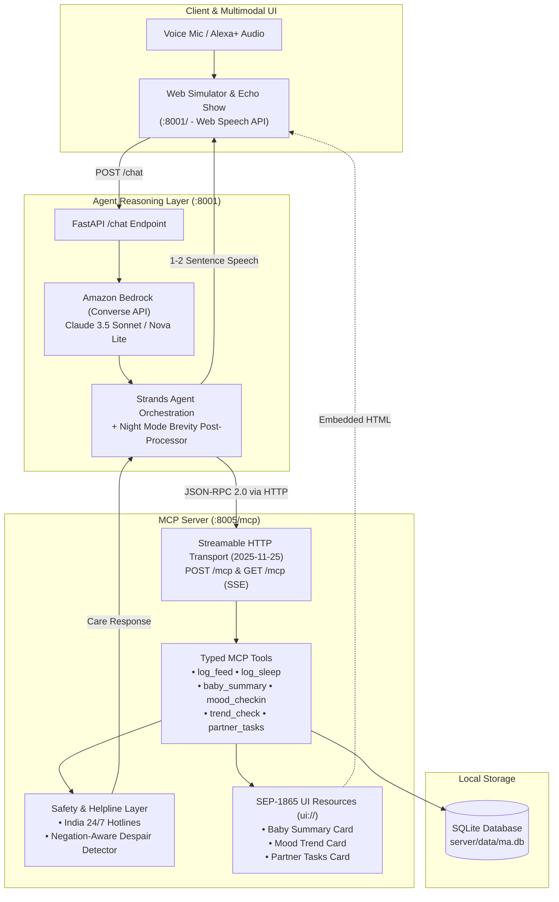

# 🌸 MA: The Voice Companion for New Mothers

[](https://opensource.org/licenses/MIT)
[](https://www.python.org/)
[](https://modelcontextprotocol.io/)
[](https://aws.amazon.com/bedrock/)
[](tests/)

> **"The ambient voice companion that cares for the mother, not just the baby."**  
> Built for the **Amazon Developer Hackathon (Alexa+ Track & AWS Builder Challenge)**.

---

## 🎥 2-Minute Video Demonstration

A synchronized walkthrough of the Echo Show 10 experience, demonstrating the self-hosted MCP server (spec `2025-11-25`, Streamable HTTP), Amazon Bedrock Converse integration, gentle voice narration, and compassionate maternal safety guardrails:

- **2-Minute Demo Video:** [`video/alexa_plus_swasth_ma_2min_demo.mp4`](video/alexa_plus_swasth_ma_2min_demo.mp4) (Full HD 1080p, **118.6 seconds (1:58)**, 5.51 MB — strictly under the 2:00 hackathon cutoff)
- **Audio Profile:** Microsoft Neural Jenny (`en-US-JennyNeural`, -3% tempo) paired with an ambient 432 Hz healing harmonic tone.

---

## 🤱 Overview

Traditional baby trackers treat new mothers like unpaid data-entry clerks at 3:00 AM, inducing anxiety and guilt with rigid statistics (*"Feeding duration below average"*). **MA** flips the paradigm: it is an ambient, compassionate voice companion built from first principles to care for the mother's mental and emotional health.

- **Hands-Free Rhythms**: Log breast feeds, bottles, and sleep naturally through Alexa+ voice commands without looking at a screen.
- **Zero Guilt & Zero Judgment**: No charts that make mom feel inadequate. Every feeding choice (nursing, formula, bottle, pumping) is celebrated equally.
- **🌙 Circadian Night Mode**: Between 10:00 PM and 6:00 AM, responses are strictly **one short, soothing sentence**, and the UI eliminates all blue light ($\lambda < 500\,\text{nm}$) with a warm velvet plum and rose palette.
- **🛡️ Intelligent Maternal Safety Layer**: Detects postpartum despair, depletion trends, and **negated self-harm** (*"I'm not going to hurt myself, but everything feels impossible"*), routing immediate support to verified Indian crisis helplines (**Tele-MANAS `14416`**, **Vandrevala Foundation `+91 9999 666 555`**).
- **🤝 Family Teamwork**: Maintains a shared **Partner Task Board** (*"Sterilize bottles"*, *"Take the 4am shift so mom can sleep"*), empowering mothers to delegate care easily.
- **🎴 SEP-1865 MCP Apps Cards**: Pairs voice tools with interactive HTML micro-cards (`ui://ma/*`) for screen-enabled devices like Echo Show.

---

## 🏗️ Architecture

MA is built on a decoupled, open-standards architecture conforming to the **Model Context Protocol (MCP)** specification (2025-11-25) over **Streamable HTTP**.



---

## 🚀 Quickstart

### 1. Prerequisites
- Python 3.11+
- Virtual environment (`venv` or `uv`)

### 2. Installation
```bash
git clone https://github.com/chiraghs/Ma.git
cd Ma

python3 -m venv .venv
source .venv/bin/activate
pip install -r requirements.txt  # Or install: mcp, fastapi, uvicorn, anyio, httpx, boto3, pytest
```

### 3. Seed Database
Seed 5 days of realistic sample rhythms for baby Maya and mother Sarah:
```bash
python server/seed.py
```

### 4. Run the MCP Server
Starts the FastMCP server over Streamable HTTP on port `8005`:
```bash
python server/main.py
```
> Verified at `http://127.0.0.1:8005/mcp`

### 5. Run the Agent API & Web Simulator
In a second terminal window (with `.venv` activated):
```bash
uvicorn agent.api:app --host 127.0.0.1 --port 8001
```

### 6. Open the Simulator
Open your browser to:
```
http://localhost:8001/
```
- Click the **Alexa Mic** or push **Start Listening** to talk.
- Try voice commands like:
  - *"Maya nursed for 15 minutes on the left side."*
  - *"How has Maya's sleep been today?"*
  - *"I'm feeling really exhausted and lonely today."*
  - *"Add a task for partner to sterilize the night bottles."*
- Toggle the **🌙 Night Mode** switch to experience the darkened circadian zero-blue interface and 1-sentence whisper responses.

---

## 🧪 Running Tests

The test suite covers all MCP tools, Streamable HTTP protocol handshakes, maternal distress classification, negation catchers, and agent contracts:

```bash
pytest -v
```

Expected output:
```
tests/test_phase1.py ...........                                  [ 40% ]
tests/test_safety.py ...........                                  [ 81% ]
tests/test_agent.py ........                                      [ 96% ]
tests/test_streamable_http.py .                                   [100%]

======================== 27 passed in 1.42s ========================
```

---

## 🛡️ Safety & Crisis Architecture

Postpartum mental health emergencies require an exceptionally delicate balance: never diagnosing or lecturing, yet never dismissing critical warning signs.

MA implements a deterministic safety layer ([server/safety.py](file:///Volumes/DiskD/Devpost/Ma/server/safety.py)):
1. **Negation-Aware Filtering**: Accurately recognizes statements like *"I'm not going to hurt myself, but I want to disappear"*, erring on the side of caution without being alarmist.
2. **Normal Exhaustion vs. Despair**: Differentiates ordinary parental fatigue (*"tired from the 3am feed"*) from severe hopelessness (*"I'm failing my baby"*, *"can't do this anymore"*).
3. **Verified Crisis Helplines**: Pre-configured with active Indian emergency numbers:
   - **Tele-MANAS**: `14416` (24/7 National Mental Health Helpline, Government of India)
   - **KIRAN**: `1800-599-0019` (24/7 Mental Health Support)
   - **Vandrevala Foundation**: `+91 9999 666 555` (24/7 Crisis Counseling)
   - **AASRA**: `+91 98204 66726`

---

## 🎨 Zero-Blue Design Philosophy

Inspired by the maternal health aesthetic of **Swasth**, the interface strictly bans all blue and cyan light spectrums ($\lambda < 500\,\text{nm}$) to protect infant and maternal circadian rhythms during midnight nursery interactions:

| Token | Hex Code | Purpose |
|---|---|---|
| **Maternal Rose** | `#FF3B69` | Primary action buttons, active states, pulse glow |
| **Soft Peach** | `#FFB088` | Secondary warm accents, gentle tags |
| **Warm Orchid** | `#C084FC` | Highlights, evening calm indicators |
| **Mint** | `#10B981` | Positive rhythms, non-critical confirmation |
| **Berry Obsidian** | `#0B050E` | High-contrast night mode backdrop |

---

## 📄 License

This project is licensed under the [MIT License](LICENSE).
