# MA Voice Companion: AWS Builder Architecture & Agent Notes

This document details the AWS services, SDKs, agentic architectural decisions, and product feedback for the **AWS Builder Mini Challenge** and **Alexa+ Hackathon Track**.

---

## 1. AWS Services Utilized

### A. Amazon Bedrock (Foundation Models & Converse API)
- **Service**: Amazon Bedrock
- **Models Targeted**:
  - `anthropic.claude-3-5-sonnet-20241022-v2:0` (High-reasoning companion, empathy, and multi-step tool calling)
  - `amazon.nova-lite-v1:0` / `amazon.nova-pro-v1:0` (Fast, cost-efficient conversational responses with low latency)
- **Role in MA**:
  - Powers natural language intent interpretation from voice transcripts.
  - Generates warm, brief 1–2 sentence companion responses without judgment.
  - Adheres strictly to the voice-first brevity rules (1 sentence during Night Mode between 10:00 PM and 6:00 AM).
  - Enforces the non-diagnostic medical guardrail.

### B. AWS SDK for Python (`boto3` / `botocore`)
- **Role**:
  - Invokes Amazon Bedrock Converse API with structured JSON tool specifications.
  - Manages secure credential resolution via IAM roles, AWS profiles, or environment variables (`AWS_ACCESS_KEY_ID`, `AWS_SECRET_ACCESS_KEY`, `AWS_SESSION_TOKEN`).

### C. Strands Agents SDK (`strands-agents`)
- **Role**:
  - High-level agent framework binding Amazon Bedrock models (`BedrockModel`) to Model Context Protocol clients (`MCPClient`).
  - Native support for tool use, agent loops, and Streamable HTTP transports.

---

## 2. End-to-End Architectural Flow

```mermaid
sequenceDiagram
    participant Mom as New Mother (Voice / Web)
    participant Alexa as Alexa+ Simulator UI (Port 8080)
    participant AgentAPI as MA Agent FastAPI (Port 8001)
    participant Bedrock as Amazon Bedrock (Claude 3.5 / Nova)
    participant MCPServer as FastMCP Server (Port 8000 /mcp)
    participant DB as SQLite (Local & Private)

    Mom->>Alexa: "Maya just fell asleep at 1pm until 2:30pm"
    Alexa->>AgentAPI: POST /chat {message, is_night_mode}
    
    rect rgb(30, 40, 60)
        note over AgentAPI: Safety & Guardrail Check
        AgentAPI->>AgentAPI: Evaluate distress & medical keywords
    end

    AgentAPI->>Bedrock: Converse API (System Prompt + MCP Tool Schemas)
    Bedrock-->>AgentAPI: ToolUse(name="log_sleep", args={start:"1pm", end:"2:30pm"})
    
    AgentAPI->>MCPServer: Streamable HTTP POST /mcp (JSON-RPC tools/call)
    MCPServer->>DB: INSERT into sleeps
    DB-->>MCPServer: Sleep ID & duration (90 mins)
    MCPServer-->>AgentAPI: Result + _meta.ui ("ui://ma/baby-summary-card")

    AgentAPI->>Bedrock: ToolResult
    Bedrock-->>AgentAPI: "Logged Maya's sleep from 1:00 PM to 2:30 PM (1h 30m)."
    AgentAPI-->>Alexa: 200 OK {reply, tool_calls, is_night_mode}
    Alexa-->>Mom: Voice Output (TTS) + Interactive Echo Show Card
```

---

## 3. Product Feedback & Developer Friction Points (For AWS Builder Team)

### What Worked Exceptionally Well:
1. **Bedrock Converse API Consistency**: The standardized Converse API request/response format across Anthropic Claude and Amazon Nova models makes swapping models seamless without changing tool definitions.
2. **Streaming & Tool Use Performance**: Tool execution latency is impressively low, critical for voice-first interactions where responses must be delivered in under 2 seconds.

### Friction Points Hit & Recommendations:
1. **MCP Streamable HTTP Transport Integration**:
   - *Observation*: While `strands-agents` has an `MCPClient`, documentation around setting up Streamable HTTP (2025-11-25 spec) with session management (`MCP-Session-Id`) over long-lived server sessions is sparse.
   - *Recommendation*: Provide official AWS Bedrock samples demonstrating native MCP client connections over HTTP/SSE.
2. **Local Development Without Active Cloud Credentials**:
   - *Observation*: Developers building during hackathons or in offline settings need a smooth mock/fallback path when AWS credentials are not yet configured or region access is restricted.
   - *Solution Built in MA*: MA implemented an intelligent fallback engine that validates intent and runs MCP tools directly over Streamable HTTP if Bedrock credentials are not present, ensuring 100% testability offline.
3. **Guardrails for Maternal Mental Health**:
   - *Observation*: Standard Bedrock Guardrails are tailored for general enterprise PII, toxicity, and financial topics. Maternal mental health requires nuanced distinction between *routine exhaustion* ("I'm exhausted from the 3am feed") and *acute distress* ("I can't do this anymore, I'm failing my baby").
   - *Recommendation*: Introduce specialized healthcare/wellness empathy guardrail presets in Bedrock Guardrails.
