# MA Voice Companion: AWS Builder Architecture & Agent Notes

This document details the AWS services, SDKs, agentic architectural decisions, and product feedback for the **AWS Builder Mini Challenge** and **Alexa+ Hackathon Track**.

---

## 1. AWS Services Utilized

### A. Amazon Bedrock (Foundation Models & Converse API)
- **Service**: Amazon Bedrock
- **Models Targeted**:
  - `anthropic.claude-3-5-sonnet-20241022-v2:0` (High-reasoning companion, empathy, and multi-step tool calling)
  - `amazon.nova-lite-v1:0` / `amazon.nova-pro-v1:0` (Fast, cost-efficient conversational responses with low latency)
- **Role in MA**:
  - Powers natural language intent interpretation from voice transcripts.
  - Generates warm, brief 1–2 sentence companion responses without judgment.
  - Adheres strictly to the voice-first brevity rules (1 sentence during Night Mode between 10:00 PM and 6:00 AM).
  - Enforces the non-diagnostic medical guardrail.

### B. AWS SDK for Python (`boto3` / `botocore`)
- **Role**:
  - Invokes Amazon Bedrock Converse API with structured JSON tool specifications.
  - Manages secure credential resolution via IAM roles, AWS profiles, or environment variables (`AWS_ACCESS_KEY_ID`, `AWS_SECRET_ACCESS_KEY`, `AWS_SESSION_TOKEN`).

### C. Strands Agents SDK (`strands-agents`)
- **Role**:
  - High-level agent framework binding Amazon Bedrock models (`BedrockModel`) to Model Context Protocol clients (`MCPClient`).
  - Native support for tool use, agent loops, and Streamable HTTP transports.

---

## 2. End-to-End Architectural Flow

```mermaid
sequenceDiagram
    participant Mom as New Mother (Voice / Web)
    participant Alexa as Alexa+ Simulator UI (Port 8080)
    participant AgentAPI as MA Agent FastAPI (Port 8001)
    participant Bedrock as Amazon Bedrock (Claude 3.5 / Nova)
    participant MCPServer as FastMCP Server (Port 8000 /mcp)
    participant DB as SQLite (Local & Private)

    Mom->>Alexa: "Maya just fell asleep at 1pm until 2:30pm"
    Alexa->>AgentAPI: POST /chat {message, is_night_mode}
    
    rect rgb(30, 40, 60)
        note over AgentAPI: Safety & Guardrail Check
        AgentAPI->>AgentAPI: Evaluate distress & medical keywords
    end

    AgentAPI->>Bedrock: Converse API (System Prompt + MCP Tool Schemas)
    Bedrock-->>AgentAPI: ToolUse(name="log_sleep", args={start:"1pm", end:"2:30pm"})
    
    AgentAPI->>MCPServer: Streamable HTTP POST /mcp (JSON-RPC tools/call)
    MCPServer->>DB: INSERT into sleeps
    DB-->>MCPServer: Sleep ID & duration (90 mins)
    MCPServer-->>AgentAPI: Result + _meta.ui ("ui://ma/baby-summary-card")

    AgentAPI->>Bedrock: ToolResult
    Bedrock-->>AgentAPI: "Logged Maya's sleep from 1:00 PM to 2:30 PM (1h 30m)."
    AgentAPI-->>Alexa: 200 OK {reply, tool_calls, is_night_mode}
    Alexa-->>Mom: Voice Output (TTS) + Interactive Echo Show Card
```

---

## 3. Official AWS Builder Friction Log (Up to 10% Bonus Rubric)

### Friction Entry 1: Bedrock Converse API Tool Schema Strictness with MCP 2025-11-25
* **Specific Task Attempted:** Binding Model Context Protocol (MCP) tool definitions directly into the Strands Agents SDK and Amazon Bedrock Converse API over the new Streamable HTTP transport.
* **Steps Taken:**
  1. Implemented typed MCP tools on FastMCP (`log_feed`, `log_sleep`, `mood_checkin`).
  2. Queried MCP server via `tools/list` over Streamable HTTP to retrieve JSON Schema tool specifications.
  3. Passed the raw tool schemas directly into the Strands Agent / Bedrock Converse `toolConfig`.
* **Expected vs. Actual Result:**
  * *Expected:* Amazon Bedrock Converse API and Strands SDK would seamlessly ingest standard MCP JSON schemas containing Pydantic-generated types, titles, and `_meta.ui` extensions.
  * *Actual:* Bedrock Converse threw a `ValidationException`: `toolConfig.tools.member.toolSpec.inputSchema.json` strictly enforces an inner `json` dictionary with `type: "object"` and disallows certain schema metadata fields (`$schema`, `title`, additional nested keywords), causing request rejections.
* **Severity Rating:** **Medium** (Blocked tool execution until custom schema sanitizer was implemented).
* **Workaround Used:** Built a client-side schema transformation bridge in `agent/agent.py` (`_mcp_to_bedrock_tools()`) that strips `$schema`, `title`, and unsupported keywords, ensuring the parameters dictionary strictly adheres to Bedrock's required format: `{"json": {"type": "object", "properties": {...}, "required": [...]}}`.
* **Actionable Suggestion:** Provide a built-in schema adapter inside the Strands Agents SDK (`strands.adapters.mcp.to_bedrock_tool()`) that automatically normalizes MCP-compliant JSON Schemas into Bedrock Converse-compatible `toolSpec` structures without manual boilerplate.

---

### Friction Entry 2: Local Development & CI/CD Testing Without Live Cloud Credentials
* **Specific Task Attempted:** Executing automated regression suites (`pytest -v`) in local development environments and CI pipelines where AWS IAM credentials are not configured or cost-prohibitive for rapid iteration.
* **Steps Taken:**
  1. Configured `boto3.client("bedrock-runtime")`.
  2. Executed test suite covering agent intent extraction and tool dispatching.
* **Expected vs. Actual Result:**
  * *Expected:* Ability to toggle an offline/mock mode within the Strands Agents SDK or boto3 to validate multi-step agent loops and tool dispatching without active AWS credentials.
  * *Actual:* `botocore.exceptions.NoCredentialsError` was raised immediately on startup, failing the test suite and preventing local agent testing when disconnected from AWS.
* **Severity Rating:** **Medium** (Slows down local developer feedback loops and breaks lightweight CI runs).
* **Workaround Used:** Implemented a dual-mode fallback loop in `agent/agent.py`: if AWS credentials are absent or fail, the agent gracefully falls back to an autonomous local heuristic parser that executes the real MCP tools directly against the local FastMCP server, allowing 100% of the 27 unit tests to pass offline.
* **Actionable Suggestion:** Introduce an official `MockBedrockClient` or `OfflineTestRunner` in the Strands Agents SDK that simulates Bedrock Converse tool-calling turns from predefined fixtures, accelerating test suites and saving API token costs during rapid prototyping.

---

## 4. Product Feedback & Recommendations (For AWS Product Teams)

### What Worked Exceptionally Well:
1. **Bedrock Converse API Consistency**: The standardized Converse API request/response format across Anthropic Claude and Amazon Nova models makes swapping models seamless without changing tool definitions.
2. **Streaming & Tool Use Performance**: Tool execution latency is impressively low, critical for voice-first interactions where responses must be delivered in under 2 seconds.

### Maternal Healthcare Guardrails Recommendation:
Standard Bedrock Guardrails are tailored for general enterprise PII, toxicity, and financial topics. Maternal mental health requires nuanced distinction between *routine exhaustion* ("I'm exhausted from the 3am feed") and *acute distress* ("I can't do this anymore, I'm failing my baby"). We recommend introducing specialized healthcare/wellness empathy guardrail presets in Bedrock Guardrails.
